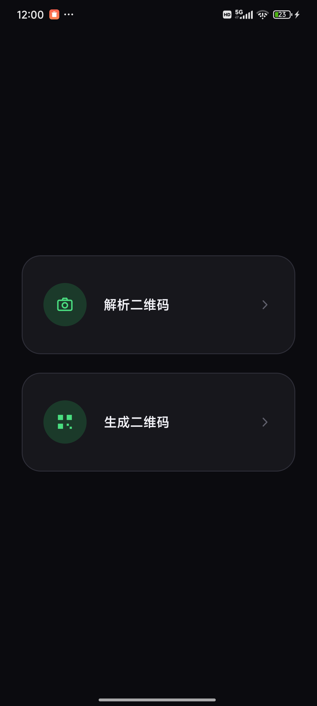
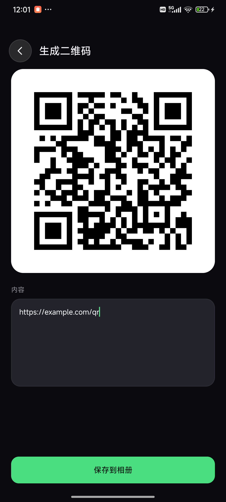
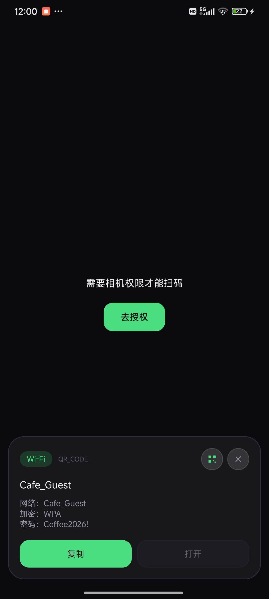

# 二维码工具（QRScan）

小巧的 Android 二维码工具：能扫，也能生成。零第三方 UI 框架、零网络权限。

包名 `com.qrscan.app`　·　minSdk 23 / targetSdk 34　·　APK 195 KB



## 功能

- **扫码**：相机逐帧识别、相册选图、外部「分享到」本应用
- **结果**：自动识别网址 / Wi-Fi / 名片 / 日历 / 电话 / 短信 / 邮件 / 位置 / OTP / 文本，可复制、可打开、可一键转成二维码
- **生成**：填文本即出码（纠错 Q），存相册 `Pictures/QRScan`
- **其他**：补光、前后摄、历史 80 条；UTF-8 与 GBK 的中文都能正确解码

| 解析 | 生成 | 结果 |
| --- | --- | --- |
|  |  |  |

## 安装

```bash
adb install -r dist/QRScan-v1.0.apk
```

MIUI / HyperOS 会弹「USB 安装提示」，点 **继续安装**。

## 构建

不需要 Gradle / Android Studio：

```powershell
powershell -ExecutionPolicy Bypass -File .\build.ps1
```

`aapt2` → `javac` → `R8` → `zipalign` → `apksigner`，产物在 `out/QRScan-v1.0.apk`。
SDK / JDK 位置读环境变量 `ANDROID_HOME` / `JAVA_HOME`，没设就按默认路径推断。

也可以在 Android Studio 里直接打开（两份 manifest 的来由见 `app/build.gradle` 注释）。

## 自动构建（GitHub Actions）

推上去就会自动出包，配置见 `.github/workflows/build.yml`：

- push 到 `main` / PR / 手动触发 → 构建完成后在 Actions 页面下载 `QRScan-apk`
- 打 `v*` 标签 → 额外建 Release 并附上 APK

签名默认是**一次性的**（每次 CI 现生成），覆盖安装手机上的旧版会因签名不同而失败。要让签名固定，把本地 `qrscan.keystore` 塞进仓库 Secrets：

```powershell
[Convert]::ToBase64String([IO.File]::ReadAllBytes("qrscan.keystore"))
```

- `KEYSTORE_BASE64` ← 上面这串
- `KEYSTORE_PASS` ← keystore 口令（默认 `android`）
## 结构

```
app/src/main/java/com/qrscan/app/
  HomeActivity      首页：选解析还是生成
  MainActivity      解析页：相机、结果卡片、历史
  GenerateActivity  生成页：输入 → 出码 → 存相册
  CameraController  Camera1 封装        ScanView      取景框自绘
  QrDecoder         静态图解码          QrEncoder     生成
  YuvQrDecoder      实时帧解码          EncodingFixer 中文修复
  Payloads          内容语义解析        HistoryStore  历史
```

## 隐私

- 没有 `INTERNET` 权限，不做任何联网
- 日志不打印解码内容；历史只存本机私有目录；`allowBackup=false`
- 权限只有 相机 / 震动 / 闪光灯（+ Android 9 及以下的存储写入）

## 已知限制

相机走 Camera1（为了零依赖）；一维码能扫但取景框是方形；生成只支持黑白二维码。

## 许可

仅作工具用途。ZXing core 遵循 Apache-2.0。